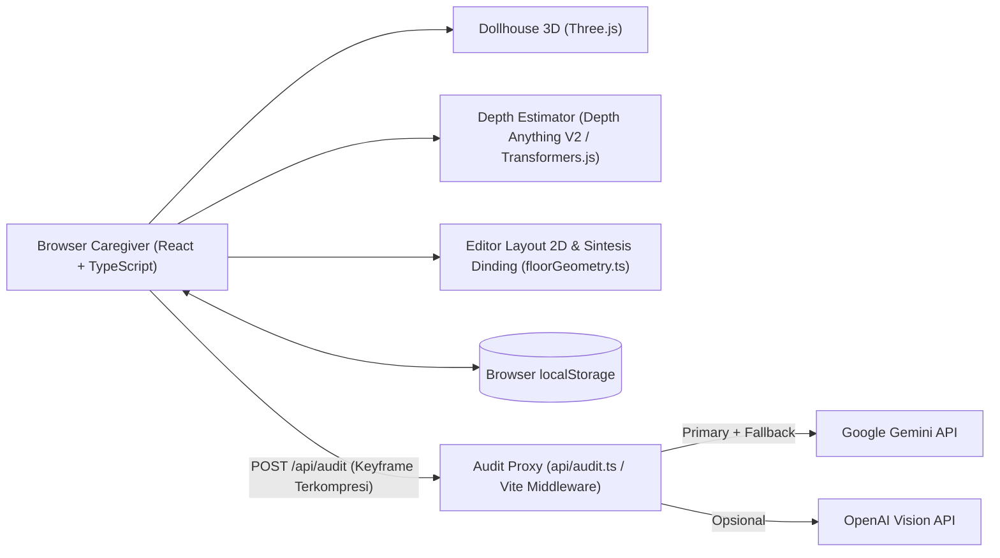
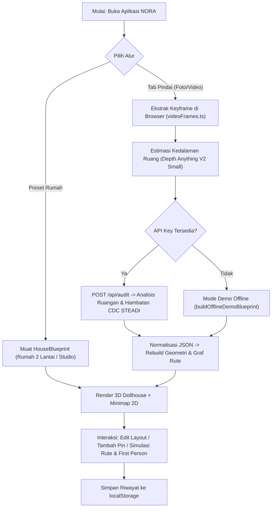

# NORA — Navigasi Rumah & Skrining Hambatan (NORA 3D)

*NORA 3D — Scan your home. Understand your space. Navigate more safely.*

NORA adalah aplikasi web interaktif yang membantu *caregiver* keluarga memetakan rumah **penderita Alzheimer** ke dalam **Digital Twin 3D Parametrik**, menyimulasikan rute aman antar-ruangan, menyunting tata letak ruangan secara langsung, serta meninjau potensi hambatan jatuh berbasis panduan **CDC STEADI**.

> **Status:** MVP hackathon. Aplikasi ini adalah alat bantu peninjauan lingkungan rumah bagi keluarga/*caregiver*, bukan alat diagnosis medis maupun pengganti pendampingan langsung.

---

## 1. Pengenalan Projek

### 1.1 Identitas Tim
| Item | Keterangan |
| --- | --- |
| Nama Tim | **MAULGROWUP** |
| Kategori Lomba | **Hackathon** |
| Nama Aplikasi | **NORA** |
| Tema | Inclusive Health & Well-being |
| Asal | Lomba Logicodix 2026 |

| Anggota | Peran |
| --- | --- |
| Mohamad Maula Aqdas Faqiha | Ide & Fitur |
| Nabil Galen Alfadzi | UI/UX & Frontend |
| Rizky Afitra | UI/UX & Frontend |
| Bachtiar Rahmad Permadi | Backend |

### 1.2 Latar Belakang
**Penderita Alzheimer** kerap mengalami gangguan memori dan disorientasi ruang (*spatial disorientation*), sehingga jalur harian di rumah sendiri—seperti dari kamar tidur menuju toilet pada malam hari—dapat memicu kebingungan hingga risiko jatuh. Di sisi lain, bahaya sederhana seperti kabel melintang, keset licin, sudut furnitur, atau lorong gelap sering luput dari perhatian keluarga.

### 1.3 Gambaran Solusi
NORA mengubah foto atau video ruangan rumah menjadi **model 3D interaktif** (*Parametric Dollhouse*) yang dapat diputar, disunting tata letaknya, dan ditelusuri layaknya simulasi langsung di dalam rumah:
- **Pindai Ruangan (Foto/Video → Denah 3D):** Browser mengekstrak *keyframe* penting, menjalankan estimasi kedalaman spasial (**Depth Anything V2**), lalu mengirim ringkasan frame ke **AI Vision** (Gemini / OpenAI) melalui `/api/audit` untuk menghasilkan struktur ruangan, furnitur, rute, dan temuan hambatan **CDC STEADI** (tersedia juga **Mode Demo Offline** tanpa API Key).
- **Atur Layout Manual:** *Caregiver* dapat langsung menyeret ruangan, mengubah dimensi (`±0.25m`), menambah/menghapus ruangan dan furnitur, memutar furnitur 90°, serta membuka/menutup pintu antar-ruangan dengan pembaruan dinding dan rute 3D secara *real-time*.
- **Navigasi Rute Aman & First-Person Walk:** Memilih ruangan asal dan tujuan untuk melihat jalur navigasi 3D lengkap dengan penunjuk arah bergaya GPS, **Auto-Jalan**, kendali **WASD**, dan *minimap* 2D.
- **Simulasi Before vs After & Mode Malam:** Membandingkan kondisi rumah sebelum dan sesudah perbaikan hambatan serta menguji visibilitas jalur pada pencahayaan malam hari.

### 1.4 Target Pengguna
- **Pengguna Utama:** Anggota keluarga dan *caregiver* yang mengatur keamanan lingkungan rumah **penderita Alzheimer**.
- **Penerima Manfaat:** **Penderita Alzheimer** maupun individu dengan keterbatasan orientasi ruang agar dapat bernavigasi lebih aman di dalam rumah.

---

## 2. Technical Documentation

### 2.1 Arsitektur Sistem



### 2.2 Diagram Alur Program



---

## 3. Frontend Documentation

### 3.1 Framework & Pustaka Utama
| Lapisan | Teknologi | Versi | Fungsi |
| --- | --- | --- | --- |
| Framework UI | React + TypeScript | `^19.1.0` / `^5.8.3` | Antarmuka pengguna & manajemen *state* |
| Build Tool | Vite | `^7.1.13` | *Dev server*, *bundler*, dan middleware proxy lokal `/api/audit` |
| 3D Engine | Three.js | `^0.175.0` | Render Dollhouse 3D, dinding, furnitur, rute, *First-Person*, & *raycasting* |
| Client-side AI Depth | `@huggingface/transformers` | `^3.5.0` | Inferensi lokal *Depth Anything V2 Small* (WebGPU/WASM) di browser |
| Ikon | `lucide-react` | `^0.511.0` | Ikon antarmuka |

### 3.2 Struktur Komponen UI & Modul (`src/`)
```text
src/
├── App.tsx                         # Root state, tab Ruangan/Pindai/Riwayat, kontrol rute, & panel kanan
├── index.css                       # Stylesheet utama & tata letak responsif
├── main.tsx                        # Entry point React DOM
├── components/
│   ├── DollhouseViewport.tsx       # Viewport Three.js: 3 mode kamera, rute 3D, Before/After, Mode Malam, pin bahaya
│   ├── FloorplanMinimap.tsx        # Minimap Denah 2D (X-Z) proporsional & indikator arah kamera
│   └── LayoutEditorPanel.tsx       # Editor 2D interaktif: drag-and-drop ruangan, resize, furnitur, & pintu
├── data/
│   └── blueprints.ts               # Definisi tipe data denah & preset rumah (2 Lantai & Studio)
├── services/
│   └── visionBlueprint.ts          # Prompt engineering AI Vision, parser respons JSON, & Mode Demo Offline
└── utils/
    ├── depthEstimator.ts           # Pipeline Depth Anything V2 di browser untuk estimasi kedalaman & lebar koridor
    ├── floorGeometry.ts            # Sintesis dinding keliling, celah pintu, snap grid, & rebuild graf rute
    └── videoFrames.ts              # Ekstraksi keyframe video lokal & kompresi gambar
```

### 3.3 Aset & Pemrosesan Media
- **Geometri Prosedural 3D:** Seluruh ruangan, dinding berpotong celah pintu, *plinth* fondasi, tangga, dan furnitur dibangun secara parametrik oleh Three.js tanpa memerlukan aset model `.glb` eksternal yang berat.
- **Model Depth Client-Side:** Saat fitur *Pindai* dijalankan, `@huggingface/transformers` mengunduh dan men-*cache* model *Depth Anything V2 Small* secara otomatis di browser (WebGPU/WASM).

---

## 4. Backend Documentation

Backend menggunakan **Vercel Serverless Function** ([api/audit.ts](api/audit.ts)) yang juga berjalan otomatis sebagai middleware pada Vite Dev Server ([vite.config.ts](vite.config.ts)) saat dijalankan di `localhost`.

### 4.1 API Endpoints

| Method | Endpoint | Deskripsi |
| --- | --- | --- |
| `POST` | `/api/audit` | Menerima *prompt* dan hingga 14 *keyframe* gambar base64, lalu meneruskannya ke **Google Gemini** atau **OpenAI Vision**. |

**Request Payload (`AuditProxyPayload`):**
```json
{
  "provider": "gemini",
  "prompt": "...",
  "frames": [
    { "mimeType": "image/jpeg", "base64": "<base64-image-data>" }
  ],
  "clientApiKey": "opsional-jika-tidak-mengisi-env-server"
}
```

**Alur Provider & Response:**
- **`provider: "gemini"` (Default):** Menggunakan `GEMINI_API_KEY` dengan urutan model `gemini-3.8-flash` → *fallback* otomatis ke `gemini-3-flash-preview` → `gemini-3.1-flash-lite`.
- **`provider: "openai"`:** Menggunakan `OPENAI_API_KEY` dengan model `gpt-4o-mini` (`response_format: json_object`).
- **Response `200 OK`:** `{ "ok": true, "modelUsed": "<nama-model>", "rawText": "<json-string>" }`.
- **Error Handling:** Status `400` (payload tidak valid), `401` (API Key belum tersedia), `405` (method bukan `POST`), atau `502` (kegagalan jaringan/provider).

### 4.2 Database & Persistence Schema
Agar dapat langsung dijalankan di laptop finalis/juri tanpa instalasi database SQL eksternal, persistensi aplikasi disimpan di **`localStorage`** browser dengan skema berikut:

| Key `localStorage` | Tipe Data | Deskripsi |
| --- | --- | --- |
| `homesafe3d_blueprint_history_v2` | `ScanHistoryEntry[]` (JSON) | Riwayat pemindaian beserta *snapshot* lengkap denah 3D (`HouseBlueprint`) |
| `homesafe3d_gemini_api_key` | `string` | API Key Gemini opsional dari input pengguna di tab *Pindai* |
| `homesafe3d_openai_api_key` | `string` | API Key OpenAI opsional dari input pengguna di tab *Pindai* |

**Skema Entitas Utama (`src/data/blueprints.ts`):**
- `HouseBlueprint`: `{ id, title, subtitle, floors: FloorPlanSpec[], hazards: HazardFinding[] }`
- `FloorPlanSpec`: `{ id, name, rooms: RoomZone[], walls: WallSegment[], furniture: FurnitureItem[], routeNodes, routeEdges, defaultFromRoomId, defaultToRoomId }`
- `RoomZone`: `{ id, label, category, floorStyle, bounds: { x, z, w, d } }`
- `HazardFinding`: `{ id, floorId, roomId, title, category, severity, position: [x, y, z], description, recommendation, remediated, reviewed }`

### 4.3 Konfigurasi `.env.example`
Templat variabel lingkungan tersedia pada [.env.example](.env.example):
```dotenv
# Salin file ini menjadi .env.local untuk menjalankan AI Vision di localhost
# Pada Vercel, isi variabel ini di Project Settings -> Environment Variables
GEMINI_API_KEY=
OPENAI_API_KEY=
```
> **Keamanan:** File `.env`, `.env.local`, dan `.env.*.local` otomatis diabaikan oleh `.gitignore` sehingga API Key tidak ikut ter-*commit* ke GitHub.

---

## 5. Petunjuk Menjalankan di Localhost

### 5.1 Prasyarat
- **Node.js** versi **18 atau lebih baru**
- **npm** (bawaan Node.js)

### 5.2 Langkah Instalasi & Menjalankan
```bash
# 1. Clone repositori
git clone https://github.com/rahmadneedsource/NORA.git
cd NORA

# 2. Install dependencies
npm install

# 3. (Opsional) Siapkan environment untuk AI Vision
cp .env.example .env.local
# Buka .env.local dan isi GEMINI_API_KEY atau OPENAI_API_KEY
# Catatan: Jika tidak diisi, aplikasi tetap berjalan penuh dengan Preset Rumah & Mode Demo Offline.

# 4. Jalankan server localhost
npm run dev
```

Setelah dijalankan, buka browser ke alamat yang muncul di terminal:
- **`http://localhost:5176`** *(port default pada `vite.config.ts`)*

### 5.3 Build Produksi & Deployment (Vercel)
```bash
npm run build     # Type-check TypeScript (tsc) & build ke dist/
npm run preview   # Preview hasil build produksi di http://localhost:5176
```
Untuk *deployment* ke **Vercel** ([vercel.json](vercel.json)), hubungkan repositori GitHub ini di dashboard Vercel, tambahkan `GEMINI_API_KEY` (dan/atau `OPENAI_API_KEY`) pada **Project Settings → Environment Variables**, lalu *deploy*.
