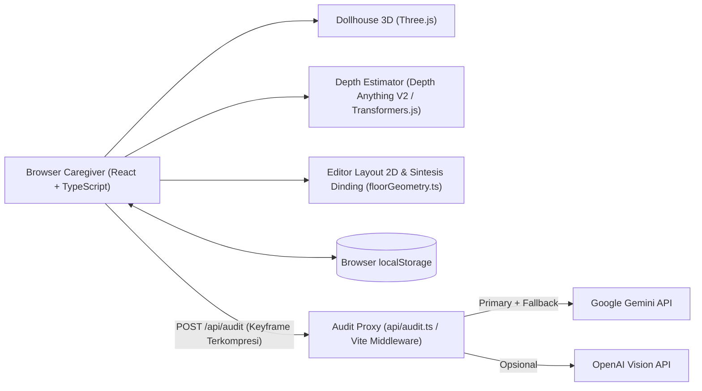
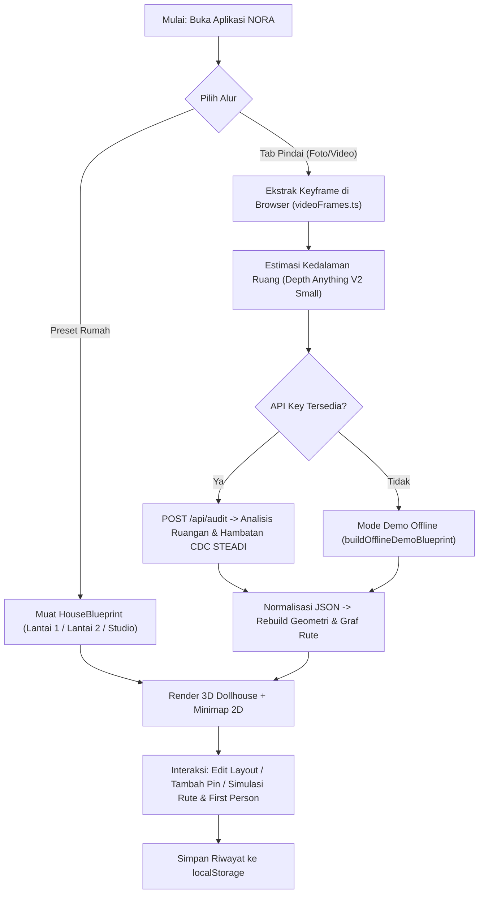

# NORA — Navigasi Rumah & Skrining Hambatan (NORA 3D)

*Scan your home. Understand your space. Navigate more safely.*

NORA adalah aplikasi web interaktif berbasis **Digital Twin 3D Parametrik** yang membantu *caregiver* keluarga memetakan rumah lansia dengan **Alzheimer**, menyimulasikan rute aman antar-ruangan dari sudut pandang **First Person**, menyunting tata letak ruangan secara langsung, serta mengidentifikasi potensi bahaya jatuh berbasis standar **CDC STEADI**.

> **Catatan:** NORA adalah alat bantu peninjauan dan simulasi lingkungan rumah bagi keluarga/*caregiver*, bukan alat diagnosis medis maupun pengganti pendampingan langsung.

---

## 1. Pengenalan Projek

### 1.1 Latar Belakang
Lansia dengan **Alzheimer** sering mengalami gangguan memori jangka pendek dan disorientasi ruang (*spatial disorientation*), sehingga jalur harian di rumah sendiri—seperti dari kamar tidur menuju toilet pada malam hari—dapat memicu kebingungan hingga risiko jatuh. Di saat yang sama, hambatan sederhana seperti kabel melintang, keset licin, sudut furnitur, atau pencahayaan redup kerap luput dari perhatian keluarga.

### 1.2 Gambaran Solusi
NORA menjembatani celah tersebut dengan mengubah foto atau video ruangan rumah menjadi **model 3D interaktif** (*Parametric Dollhouse*) yang ringan dan dapat langsung disunting:
- **Pindai Ruangan Berbasis AI:** Mengubah foto/video rumah menjadi denah 3D lengkap dengan deteksi hambatan jatuh **CDC STEADI** (mendukung Gemini Vision, OpenAI Vision, dan *Mode Demo Offline*).
- **Atur Layout Manual:** *Caregiver* dapat menggeser ruangan, mengubah ukuran (`±0.25m`), menambah/menghapus ruangan dan furnitur, memutar furnitur, serta mengatur bukaan pintu antar-ruangan secara *real-time*.
- **Navigasi Rute Aman & First-Person Walk:** Menampilkan jalur terpendek antar-ruangan lengkap dengan panduan belokan bergaya GPS, **Auto-Jalan**, kontrol keyboard `WASD`, dan *minimap* 2D.
- **Simulasi Before vs After & Mode Malam:** Membandingkan kondisi rumah sebelum dan sesudah mitigasi hambatan serta menguji visibilitas jalur saat malam hari.

### 1.3 Target Pengguna
- **Pengguna Utama:** Anggota keluarga dan *caregiver* yang merawat atau menata keamanan rumah lansia.
- **Penerima Manfaat:** Lansia dengan Alzheimer atau keterbatasan mobilitas agar dapat bernavigasi lebih aman di dalam rumah.

### 1.4 Identitas Tim
| Nama Tim | Kategori | Ajang |
| --- | --- | --- |
| **Tim NORA** | Web | Logicodix 2026 |

| Anggota | Peran |
| --- | --- |
| Mohamad Maula Aqdas Faqiha | Ide & Fitur |
| Nabil Galen Alfadzi | UI/UX & Frontend |
| Rizky Afitra | UI/UX & Frontend |
| Bachtiar Rahmad Permadi | Backend |

---

## 2. Technical Documentation

### 2.1 Arsitektur Sistem



### 2.2 Diagram Alur Program



---

## 3. Frontend Documentation

### 3.1 Framework & Pustaka Utama
| Teknologi | Versi | Fungsi |
| --- | --- | --- |
| **React** | `^19.1.0` | Antarmuka pengguna & manajemen *state* |
| **TypeScript** | `^5.8.3` | Keamanan tipe data denah, graf rute, dan respons AI |
| **Vite** | `^7.1.13` | *Build tool*, *dev server*, dan proxy lokal `/api/audit` |
| **Three.js** | `^0.175.0` | Rendering 3D Dollhouse, dinding, furnitur, rute, kamera *First Person*, & *raycasting* |
| **@huggingface/transformers** | `^3.5.0` | Inferensi lokal *Depth Anything V2 Small* (WebGPU/WASM) di browser |
| **lucide-react** | `^0.511.0` | Ikon UI modern |

### 3.2 Struktur Komponen UI & Modul `src/`
```text
src/
├── App.tsx                         # Root state, tab Ruangan/Pindai/Riwayat, kontrol rute & panel kanan
├── index.css                       # Stylesheet utama aplikasi & tata letak responsif
├── main.tsx                        # Entry point React DOM
├── components/
│   ├── DollhouseViewport.tsx       # Kanvas Three.js: 3 mode kamera, rute ungu beranimasi, Before/After, Mode Malam, pin bahaya
│   ├── FloorplanMinimap.tsx        # Minimap Denah 2D (X-Z) dengan skala proporsional & indikator arah kamera
│   └── LayoutEditorPanel.tsx       # Editor 2D interaktif: drag-and-drop ruangan, resize, furnitur, & pintu
├── data/
│   └── blueprints.ts               # Definisi tipe data (HouseBlueprint, FloorPlanSpec, HazardFinding) & preset rumah
├── services/
│   └── visionBlueprint.ts          # Prompt engineering AI Vision, parser respons JSON, & Mode Demo Offline
└── utils/
    ├── depthEstimator.ts           # Pipeline Depth Anything V2 di browser untuk estimasi kedalaman & lebar lorong
    ├── floorGeometry.ts            # Sintesis dinding keliling, pemotongan celah pintu, snap grid, & rebuild graf rute
    └── videoFrames.ts              # Ekstraksi keyframe video MP4/WEBM & kompresi gambar sebelum dikirim ke API
```

### 3.3 Aset & Pemrosesan Media
- **Geometri Prosedural 3D:** Seluruh ruangan, dinding, bukaan pintu, *plinth* fondasi, tangga, dan furnitur dirender secara parametrik oleh Three.js tanpa bergantung pada file model `.glb` eksternal yang berat.
- **Model Depth Client-Side:** Saat pemindaian aktif, `@huggingface/transformers` mengunduh dan men-*cache* model *Depth Anything V2 Small* secara otomatis di *cache* browser (WebGPU/WASM).

---

## 4. Backend Documentation

Backend dirancang ringan menggunakan **Vercel Serverless Function** ([api/audit.ts](api/audit.ts)) dan terintegrasi langsung ke Vite Dev Server ([vite.config.ts](vite.config.ts)) saat dijalankan di `localhost`, sehingga tidak membutuhkan server backend terpisah.

### 4.1 API Endpoints

| Method | Endpoint | Deskripsi |
| --- | --- | --- |
| `POST` | `/api/audit` | Menerima *prompt* terstruktur dan hingga 14 *keyframe* gambar base64, lalu meneruskannya ke provider AI Vision (Gemini atau OpenAI). |

**Request Payload (`AuditProxyPayload`):**
```json
{
  "provider": "gemini",
  "prompt": "...",
  "frames": [
    { "mimeType": "image/jpeg", "base64": "<base64-image-data>" }
  ],
  "clientApiKey": "opsional-jika-tidak-pakai-env-server"
}
```

**Alur Provider & Response:**
- **`provider: "gemini"` (Default):** Menggunakan `GEMINI_API_KEY` dengan urutan model `gemini-3.8-flash` → *fallback* otomatis ke `gemini-3-flash-preview` → `gemini-3.1-flash-lite`.
- **`provider: "openai"`:** Menggunakan `OPENAI_API_KEY` dengan model `gpt-4o-mini` (`response_format: json_object`).
- **Response `200 OK`:** `{ "ok": true, "modelUsed": "<nama-model>", "rawText": "<json-string>" }`.
- **Error Handling:** Mengembalikan status `400` (payload tidak valid), `401` (API Key belum tersedia), `405` (method bukan `POST`), atau `502` (kegagalan jaringan/provider).

### 4.2 Skema Data & Penyimpanan (*Database / Persistence Schema*)
Aplikasi tidak memerlukan database SQL eksternal agar dapat langsung dijalankan di laptop finalis/juri tanpa konfigurasi tambahan. Seluruh data riwayat pemindaian dan konfigurasi disimpan di **`localStorage`** browser dengan skema berikut:

| Key `localStorage` | Tipe Data | Deskripsi |
| --- | --- | --- |
| `homesafe3d_blueprint_history_v2` | `ScanHistoryEntry[]` (JSON) | Riwayat pemindaian beserta *snapshot* penuh denah 3D (`HouseBlueprint`) |
| `homesafe3d_gemini_api_key` | `string` | API Key Gemini opsional yang dimasukkan pengguna via UI tab *Pindai* |
| `homesafe3d_openai_api_key` | `string` | API Key OpenAI opsional yang dimasukkan pengguna via UI tab *Pindai* |

**Struktur Skema Entitas Utama (`src/data/blueprints.ts`):**
- `HouseBlueprint`: `{ id, title, subtitle, floors: FloorPlanSpec[], hazards: HazardFinding[] }`
- `FloorPlanSpec`: `{ id, name, rooms: RoomZone[], walls: WallSegment[], furniture: FurnitureItem[], routeNodes, routeEdges, defaultFromRoomId, defaultToRoomId }`
- `RoomZone`: `{ id, label, category, floorStyle, bounds: { x, z, w, d } }`
- `HazardFinding`: `{ id, floorId, roomId, title, category, severity, position: [x, y, z], description, recommendation, remediated, reviewed }`

### 4.3 Konfigurasi `.env.example`
File [.env.example](.env.example) disediakan di *root* repositori sebagai templat variabel lingkungan:
```dotenv
# Salin file ini menjadi .env.local untuk menjalankan AI Vision di localhost
# Pada Vercel, isi variabel ini di Project Settings -> Environment Variables
GEMINI_API_KEY=
OPENAI_API_KEY=
```
> **Keamanan:** File `.env`, `.env.local`, dan `.env.*.local` otomatis diabaikan oleh `.gitignore`.

---

## 5. Petunjuk Menjalankan di Localhost

### 5.1 Prasyarat
- **Node.js** versi **18 atau lebih baru**
- **npm** (bawaan Node.js)

### 5.2 Langkah Instalasi & Menjalankan
```bash
# 1. Clone repositori ini
git clone https://github.com/rahmadneedsource/NORA.git
cd NORA

# 2. Install seluruh dependencies
npm install

# 3. (Opsional) Salin .env.example menjadi .env.local untuk mengaktifkan AI Vision
cp .env.example .env.local
# Buka .env.local dan isi GEMINI_API_KEY atau OPENAI_API_KEY
# Catatan: Jika dikosongkan, aplikasi tetap berjalan penuh dengan Preset Rumah & Mode Demo Offline.

# 4. Jalankan server localhost
npm run dev
```

Setelah dijalankan, buka browser ke alamat yang muncul di terminal:
- **`http://localhost:5176`** *(port default di `vite.config.ts`)*

### 5.3 Perintah Tambahan (Build Produksi)
```bash
npm run build     # Type-check TypeScript (tsc) & build bundle produksi ke dist/
npm run preview   # Menjalankan preview hasil build produksi di http://localhost:5176
```
