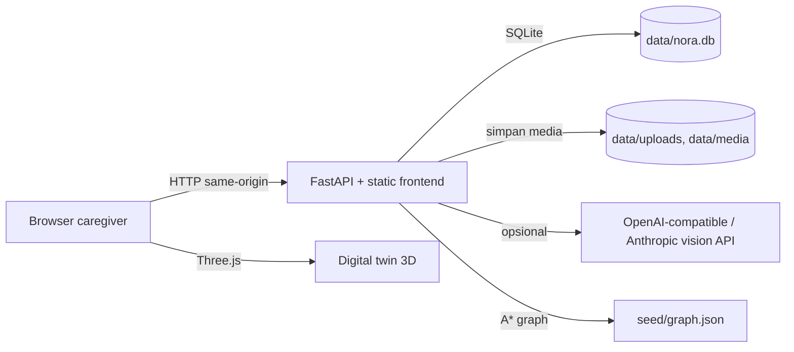

# NORA

**NORA — Navigasi Rumah & Skrining Hambatan**
*NORA 3D — Scan your home. Understand your space. Navigate more safely.*

NORA adalah aplikasi web yang membantu caregiver keluarga memetakan rumah lansia
dengan Alzheimer, menelusuri rute antar-ruangan pada digital twin 3D, dan
meninjau potensi hambatan yang terlihat di sepanjang jalur tersebut.

> **Status:** MVP hackathon. Aplikasi ini alat bantu peninjauan lingkungan rumah,
> bukan alat diagnosis, bukan penilaian klinis, dan bukan pengganti pendampingan
> caregiver.

---

## 1. Identitas Tim

| Item | Keterangan |
| --- | --- |
| Nama tim | **Tim NORA** |
| Kategori lomba | **Web** |
| Nama aplikasi | **NORA** |
| Nama konsep | HomeSafe 3D |
| Asal | Lomba Logicodix 2026 |

| Anggota | Peran |
| --- | --- |
| Mohamad Maula Aqdas Faqiha | Ide & fitur |
| Nabil Galen Alfadzi | UI/UX & Frontend |
| Rizky Afitra | UI/UX & Frontend |
| Bachtiar Rahmad Permadi | Backend |

---

## 2. Deskripsi Aplikasi

NORA mengubah cara keluarga memahami rumah lansia: dari daftar ruangan yang
abstract menjadi model rumah dua lantai yang bisa diputar, dipilih, dan
ditelusuri. Pengguna dapat memilih lokasi asal dan tujuan, melihat rute yang
dihitung dengan A* pada graph navigasi, serta melihat potensi hambatan yang
berada pada segmen jalur tersebut.

Pemindaian media nyata juga tersedia. Pengguna mengunggah video atau beberapa
foto ruangan; server mengekstrak frame dengan FFmpeg, menghitung kualitas visual
(kecerahan, ketajaman, dan tumpang tindih antar-frame dengan ORB), lalu secara
opsional mengirim frame terpilih ke model vision melalui API yang kompatibel
dengan OpenAI. Jika AI tidak dikonfigurasi atau gagal, server **tidak
mengarang temuan**: hasilnya hanya peringatan kualitas frame dan ditandai
`quality_only` atau `degraded`.

---

## 3. Masalah yang Ingin Dibantu

Lansia dengan Alzheimer dapat mengalami gangguan memori dan orientasi, sehingga
rumah yang familiar pun bisa terasa sulit dikenali. Di sisi lain, rumah sering
memiliki hambatan sederhana yang luput dari perhatian: kabel melintang, keset
yang mudah bergeser, barang di jalur berjalan, atau pencahayaan yang kurang.

Keluarga dan caregiver membutuhkan satu tempat untuk:

1. mendokumentasikan kondisi ruangan,
2. memahami hubungan antar-ruangan,
3. merencanakan jalur menuju ruangan penting, dan
4. mencatat serta memverifikasi potensi hambatan sebelum diperbaiki.

NORA mengerjakan keempat hal itu dalam satu antarmuka web yang ringan dan bisa
dijalankan di VPS kecil.

---

## 4. Target Pengguna

- **Pengguna utama:** anggota keluarga dan caregiver yang mengatur rumah lansia.
- **Penerima manfaat:** lansia dengan Alzheimer atau keterbatasan mobilitas yang
  tinggal di rumah tersebut.
- **Konteks penggunaan:** peninjauan rumah bersama keluarga, perencanaan
  perbaikan, dan persiapan rute sehari-hari.

---

## 5. Fitur Utama

### 5.1 Digital twin 3D dua lantai

- Viewer Three.js dengan dua lantai, dinding, furnitur, tangga, dan label ruangan.
- Pin lokasi dan pin hambatan yang mengikuti proyeksi kamera 3D.
- Kontrol orbit, zoom, reset kamera, serta perpindahan lantai.
- Mode gerak minimal dan preferensi aksesibilitas.

### 5.2 Navigasi A* dan panduan langkah

- Graph navigasi 17 node dan 16 edge, termasuk edge tangga antar-lantai (`e12`).
- Rute yang sama dihitung di backend (otoritatif) dan di frontend sebagai
  fallback saat server tidak tersedia.
- Rute antar-lantai otomatis melewati tangga dan menampilkan jumlah segmen.
- Panduan langkah per segmen, dengan opsi suara bahasa Indonesia melalui Web
  Speech API bawaan browser.

### 5.3 Manajemen lokasi

- Tambah, ubah, dan hapus lokasi dengan kategori, ikon, lantai, posisi 3D, dan
  titik akses graph.
- Foto referensi ruangan dapat diunggah ke server.
- Lokasi tanpa titik akses ditandai `Perlu pengaturan jalur` dan tidak dipaksa
  menghasilkan rute.

### 5.4 Pemindaian media yang jujur

- Unggah hingga 20 file (JPG, PNG, WEBP, MP4, MOV, WEBM) dengan batas total
  default 200 MB.
- Ekstraksi frame video dengan FFmpeg; foto dinormalisasi dan dibuat thumbnail.
- Analisis kualitas: kecerahan, blur (variance of Laplacian), dan tumpang tindih
  antar-frame (ORB + homografi).
- Analisis AI opsional melalui provider OpenAI-compatible (OpenRouter, OpenAI,
  Ollama, LM Studio) atau adapter Anthropic-compatible.
- Temuan AI harus diterima atau diabaikan secara eksplisit; temuan yang diterima
  baru menjadi catatan hambatan berstatus `Perlu diperiksa`.
- Tanpa AI: tidak ada temuan palsu, hanya peringatan kualitas dan batasan.

### 5.5 Manajemen hambatan

- Kategori: tersandung, terpeleset, pencahayaan, mobilitas, akses, lainnya.
- Prioritas, deskripsi, rekomendasi, bukti visual, dan titik pada peta.
- Status verifikasi caregiver: `Perlu diperiksa`, `Sudah ditangani`,
  `Tidak relevan`.
- Hambatan aktif pada segmen rute ikut ditampilkan; sistem dapat menghitung
  kandidat jalur alternatif yang menghindari edge terdampak.

### 5.6 Riwayat dan reset demo

- Riwayat aktivitas dan pemindaian tersimpan di server.
- Semua data demo dapat dikembalikan ke kondisi awal dari menu Pengaturan.

### 5.7 Mode lokal

- Frontend tetap dapat dipakai tanpa backend menggunakan `localStorage`.
- Badge di header menunjukkan `Server aktif` atau `Mode lokal` secara jujur.
- Semua operasi tulis mencoba server lebih dulu, lalu jatuh ke penyimpanan lokal
  bila server tidak tersedia.

---

## 6. Akun Demo

**Tidak ada akun demo dan tidak ada autentikasi.** Aplikasi dibuka langsung,
menggunakan data rumah contoh yang sudah di-seed. Untuk mengembalikan data ke
kondisi awal, buka **Pengaturan → Atur Ulang Data Demo**.

Sebelum dipublikasikan di internet, pasang autentikasi atau batasi akses di
level reverse proxy/VPN. Lihat [docs/PRIVACY.md](docs/PRIVACY.md).

### Video demo

Skenario rekaman 3–5 menit, daftar persiapan, dan narasi tersedia di
[docs/DEMO_SCRIPT.md](docs/DEMO_SCRIPT.md). Video harus direkam dari aplikasi
yang benar-benar berjalan pada commit final, tanpa mockup atau hasil tempelan.

---

## 7. Tech Stack

| Lapisan | Teknologi | Catatan |
| --- | --- | --- |
| Frontend | HTML, CSS, JavaScript (single-file) | `frontend/index.html` |
| Styling | Tailwind CSS 3.4 | Build Play CDN di-vendor lokal |
| 3D | Three.js r128 + OrbitControls | Di-vendor lokal |
| Ikon | Lucide 0.468 | Di-vendor lokal |
| Font | Inter (400–700) | WOFF2 latin, di-vendor lokal |
| Backend | Python 3.10+ / FastAPI | Factory `app.main:create_app` |
| Server | Uvicorn | Menyajikan API dan frontend statis |
| Database | SQLite via `sqlite3` bawaan | Tanpa ORM |
| Media | Pillow, OpenCV, FFmpeg/FFprobe | Ekstraksi frame dan kualitas |
| AI (opsional) | API OpenAI-compatible / Anthropic-compatible | `httpx` |
| Testing | pytest + FastAPI TestClient | 30 tes |
| Deployment | Docker, Docker Compose, Nginx/Caddy | Lihat `docs/DEPLOY.md` |

Tidak ada CDN eksternal saat runtime. Tailwind, Three.js, OrbitControls, Lucide,
dan font Inter disimpan di `frontend/vendor/` agar demo tetap berjalan meski
jaringan venue buruk.

---

## 8. Arsitektur



Alur pemindaian:

```text
upload -> validasi -> simpan -> ekstraksi frame -> kualitas/overlap
       -> analisis AI (opsional) -> status ready / degraded / quality_only
```

Detail komponen, model data, dan penanganan kegagalan ada di
[docs/ARCHITECTURE.md](docs/ARCHITECTURE.md).

---

## 9. Struktur Repositori

```text
.
├── backend/
│   ├── app/
│   │   ├── config.py          # env, path, status AI
│   │   ├── db.py              # skema SQLite, seed, reset
│   │   ├── repository.py      # akses data, mapping camelCase
│   │   ├── schemas.py         # model Pydantic
│   │   ├── seed_data.py       # data rumah contoh
│   │   ├── seed/graph.json    # graph navigasi 17 node / 16 edge
│   │   ├── routers/           # system, locations, hazards, navigation, scans, ...
│   │   └── services/          # navigation, frames, quality, vision, pipeline, storage
│   ├── requirements.txt
│   └── tests/                 # 30 tes API + pipeline
├── frontend/
│   ├── index.html             # aplikasi lengkap
│   └── vendor/                # Tailwind, Three.js, Lucide, Inter
├── docs/                      # arsitektur, API, AI, privasi, demo, deploy, atribusi
├── scripts/                   # pemeriksaan higiene repo dan smoke test
├── deploy/                    # contoh konfigurasi Nginx dan Caddy
├── Dockerfile
├── docker-compose.yml
├── Makefile
├── pytest.ini
├── .env.example
└── README.md
```

---

## 10. Menjalankan Secara Lokal

### Prasyarat

- Python 3.10 atau lebih baru
- FFmpeg dan FFprobe (untuk pemindaian video)
- Git (opsional)

Ubuntu/Debian:

```bash
sudo apt update
sudo apt install -y python3 python3-venv python3-pip ffmpeg
```

### Langkah

```bash
git clone <URL_REPO_ANDA> nora
cd nora

python3 -m venv .venv
source .venv/bin/activate
pip install -r backend/requirements.txt

cp .env.example .env
# Edit .env bila ingin mengaktifkan AI vision. Tanpa API key,
# aplikasi tetap berjalan dalam mode quality_only.

PYTHONPATH=backend uvicorn app.main:create_app --factory \
  --host 0.0.0.0 --port 8000
```

Buka <http://127.0.0.1:8000>. Frontend dan API dilayani dari origin yang sama,
jadi tidak ada konfigurasi CORS tambahan untuk penggunaan normal.

Alternatif dengan Makefile:

```bash
make install
make run
```

Hentikan server dengan `Ctrl+C`.

### Menjalankan dengan Docker

```bash
cp .env.example .env
# isi AI_API_KEY bila perlu
docker compose up -d --build
docker compose logs -f nora
```

Panduan lengkap VPS, domain, HTTPS, backup, dan pembaruan ada di
[docs/DEPLOY.md](docs/DEPLOY.md).

---

## 11. Konfigurasi

Semua konfigurasi dibaca dari environment atau file `.env` di root proyek.
`.env` tidak boleh di-commit.

| Variabel | Default | Keterangan |
| --- | --- | --- |
| `APP_ENV` | `development` | Label lingkungan |
| `DATA_DIR` | `./data` | Lokasi SQLite, upload, dan media |
| `CORS_ORIGINS` | `localhost:8000,127.0.0.1:8000` | Origin browser yang diizinkan |
| `AI_PROVIDER` | `none` di kode; contoh `.env` memakai `openai_compatible` | `openai_compatible`, `anthropic`, atau `none` |
| `AI_BASE_URL` | kosong / OpenRouter untuk `openai_compatible` | Base URL API |
| `AI_API_KEY` | kosong | **Isi hanya di `.env` lokal/VPS** |
| `AI_MODEL` | `google/gemini-2.5-flash` saat provider aktif | Model harus mendukung input gambar |
| `AI_APP_NAME` | `NORA` | Header atribusi opsional |
| `AI_APP_URL` | kosong | Header `HTTP-Referer` opsional untuk OpenRouter |
| `AI_TIMEOUT_SECONDS` | `60` | Batas waktu panggilan AI |
| `AI_MAX_FRAMES` | `6` | Frame maksimum yang dikirim ke AI |
| `AI_MAX_IMAGE_PX` | `768` | Resolusi sisi terpanjang gambar untuk AI |
| `MAX_UPLOAD_MB` | `200` | Batas total unggahan per pemindaian |
| `MAX_FILES` | `20` | Batas jumlah file per pemindaian |
| `FFMPEG_BIN` | `ffmpeg` | Path binary FFmpeg |
| `FFPROBE_BIN` | `ffprobe` | Path binary FFprobe |

Jika `AI_PROVIDER=openai_compatible` tetapi `AI_API_KEY` kosong dan base URL
bukan localhost, sistem otomatis berjalan dalam mode `quality_only`.

Contoh konfigurasi OpenRouter:

```dotenv
AI_PROVIDER=openai_compatible
AI_BASE_URL=https://openrouter.ai/api/v1
AI_MODEL=google/gemini-2.5-flash
AI_API_KEY=isi_di_env_lokal_anda
```

Contoh Ollama lokal:

```dotenv
AI_PROVIDER=openai_compatible
AI_BASE_URL=http://localhost:11434/v1
AI_MODEL=llava
AI_API_KEY=
```

Dokumentasi AI lebih lengkap: [docs/AI.md](docs/AI.md).

---

## 12. Dokumentasi AI

- **API utama:** OpenAI-compatible (`POST {AI_BASE_URL}/chat/completions`),
  sehingga OpenRouter, OpenAI, Groq, Ollama, dan LM Studio dapat dipakai tanpa
  perubahan kode.
- **Adapter opsional:** Anthropic-compatible (`/v1/messages`).
- **Masukan:** maksimal 6 frame terpilih, tanpa audio dan tanpa metadata lokasi
  perangkat.
- **Keluaran:** JSON dengan ringkasan, temuan, prioritas, rekomendasi,
  keyakinan, dan batasan.
- **Pengaman:** prompt melarang diagnosis medis, klaim "rute aman", dan temuan
  yang tidak terlihat. Hanya temuan dengan keyakinan yang masuk akal yang
  ditampilkan; caregiver harus menerima atau mengabaikan setiap temuan.
- **Kegagalan:** jika API key tidak ada, provider menolak, timeout, atau respons
  tidak valid, pipeline **tidak membuat temuan** dan menandai mode `degraded`.
- **Biaya:** hanya frame terpilih yang dikirim. Dengan 6 frame 768 px, satu
  pemindaian biasanya mengirim beberapa ratus KB gambar.

Detail prompt, skema, dan batasan: [docs/AI.md](docs/AI.md).

---

## 13. API

Dokumentasi interaktif tersedia di `/api/docs` saat server berjalan. Ringkasan
endpoint dan contoh request ada di [docs/API.md](docs/API.md).

Endpoint utama:

- `GET /api/health`, `GET /api/bootstrap`
- `POST /api/navigation/route`, `GET /api/navigation/graph`
- `GET/POST/PATCH/DELETE /api/locations`
- `GET/POST/PATCH/DELETE /api/hazards`
- `POST /api/uploads/photo`
- `POST /api/scans`, `GET /api/scans/{id}`, `GET /api/scans/{id}/events`
- `POST /api/scans/{id}/findings/{findingId}/accept`
- `POST /api/scans/{id}/findings/{findingId}/dismiss`
- `GET/POST/DELETE /api/history`
- `POST /api/demo/reset`

---

## 14. Pengujian

```bash
python3 -m pytest -q
```

Jika mesin Anda memiliki plugin pytest pihak ketiga yang rusak, jalankan:

```bash
PYTEST_DISABLE_PLUGIN_AUTOLOAD=1 python3 -m pytest -q
```

Cakupan tes:

- health, bootstrap, graph, dan seed
- rute satu lantai, lintas lantai, lokasi tidak dikenal
- CRUD lokasi, validasi lantai/kategori/ikon, unggah/hapus foto
- CRUD hambatan, validasi edge/prioritas/status
- riwayat dan reset demo
- pemindaian foto dan video, ekstraksi frame, kualitas, mode tanpa AI
- penerimaan/penolakan temuan, pembuatan hambatan, dan konsistensi hapus
- adapter vision: respons valid, JSON rusak, jaringan gagal, AI nonaktif
  (tanpa memanggil API eksternal)

Pemeriksaan higiene repo:

```bash
bash scripts/check_repo_hygiene.sh
```

Smoke test terhadap server yang berjalan:

```bash
BASE_URL=http://127.0.0.1:8000 bash scripts/smoke_test.sh
```

---

## 15. Deployment

Ringkasan:

1. Siapkan VPS Ubuntu, domain, dan DNS A record.
2. Install Docker, Docker Compose, dan reverse proxy (Nginx atau Caddy).
3. Clone repo, salin `.env.example` menjadi `.env`, isi AI key bila perlu.
4. `docker compose up -d --build`.
5. Arahkan reverse proxy ke `127.0.0.1:8000`, aktifkan HTTPS.
6. Batasi akses (autentikasi dasar, VPN, atau allowlist) sebelum membuka data
   rumah ke publik.

Konfigurasi contoh:

- `deploy/nginx.conf`
- `deploy/Caddyfile`
- [docs/DEPLOY.md](docs/DEPLOY.md)

---

## 16. Batasan yang Diakui

Kami sengaja menuliskan batasan ini agar demo tidak menyesatkan:

1. **Digital twin adalah model demo yang sudah dibangun**, bukan hasil
   rekonstruksi otomatis dari video pengguna. Scan pengguna memvalidasi kualitas
   media dan (bila aktif) menghasilkan temuan visual; model 3D tidak berubah
   otomatis dari hasil scan.
2. **Tidak ada COLMAP, SLAM, atau 3D Gaussian Splatting** dalam pipeline saat
   ini. Arsitektur menyediakan tempat untuk itu, tetapi fitur tersebut tidak
   diklaim sudah ada.
3. **Graph navigasi adalah graph yang dikurasi**, bukan hasil ekstraksi geometri
   otomatis. Rute hanya seakurat graph dan titik akses yang diisi.
4. **Skala metrik tidak dijamin.** Jarak dan lebar lorong tidak boleh dipakai
   sebagai pengukuran dunia nyata tanpa kalibrasi.
5. **AI adalah skrining awal.** AI tidak dapat memastikan permukaan licin, tidak
   melihat area di luar frame, dan tidak menggantikan penilaian caregiver.
6. **Belum ada autentikasi.** Deployment publik harus dilindungi di level
   reverse proxy atau ditambah autentikasi terlebih dahulu.
7. **SQLite satu node.** Cocok untuk demo dan rumah tunggal; bukan untuk banyak
   penulisan paralel skala besar.

---

## 17. Privasi dan Keamanan

- Tidak ada API key di dalam repo. Semua kredensial dibaca dari `.env`.
- Data rumah disimpan di server yang Anda jalankan sendiri.
- Gambar yang dikirim ke AI hanya frame terpilih, bukan video penuh.
- Tidak ada analytics, tracking pixel, atau CDN pihak ketiga saat runtime.
- `.env`, `data/`, dan file PDF panduan diabaikan oleh Git.
- Detail dan rekomendasi hardening: [docs/PRIVACY.md](docs/PRIVACY.md).

---

## 18. Atribusi dan Orisinalitas

Kode aplikasi, alur produk, dan desain antarmuka ditulis oleh Tim NORA untuk
Logicodex 2026. Pustaka pihak ketiga digunakan sesuai lisensinya dan dicantumkan
di [docs/ATTRIBUTIONS.md](docs/ATTRIBUTIONS.md):

- Three.js r128 — MIT
- OrbitControls — MIT
- Tailwind CSS 3.4 — MIT
- Lucide 0.468 — ISC
- Inter — SIL Open Font License 1.1
- FastAPI, Uvicorn, Pydantic, Pillow, OpenCV, NumPy, httpx, pytest — lihat
  dokumen atribusi
- FFmpeg — dependensi sistem, lisensi build masing-masing

Tidak ada hasil demo yang di-hardcode atau difabrikasi. Pemindaian tanpa AI
secara eksplisit menghasilkan nol temuan.

---

## 19. Lisensi

Hak cipta kode aplikasi: Tim NORA, 2026. Repositori ini disiapkan untuk
kebutuhan Lomba Logicodex 2026. Lisensi distribusi kode aplikasi belum
ditetapkan; pustaka dan aset pihak ketiga tetap tunduk pada lisensi
masing-masing seperti tercantum di [docs/ATTRIBUTIONS.md](docs/ATTRIBUTIONS.md).
